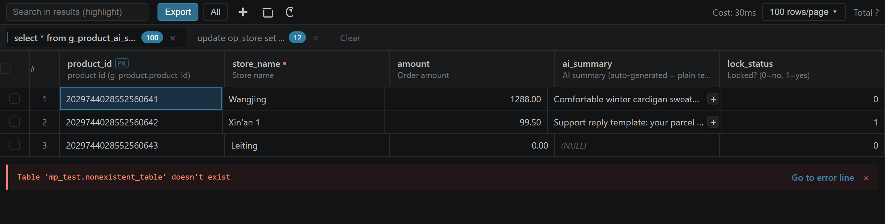
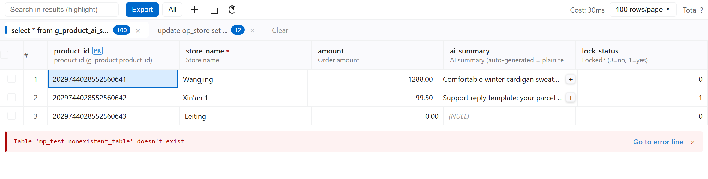

<div align="center">

# MySQL Custom

**A MySQL / MariaDB client for VS Code, built for very large and very complex SQL.**

[](LICENSE)
[](https://code.visualstudio.com/)
[](https://www.mysql.com/)

[English](README.md) · [简体中文](README_CN.md)



</div>

---

## Why this exists

The upstream project went closed-source from v4.7.0. This build starts from the last MIT release ([cweijan/vscode-database-client](https://github.com/cweijan/vscode-database-client) **v3.9.8**, no paid gating) and adds targeted improvements driven by a real production codebase:

| | |
|---|---|
| Mapper files | **1,093** MyBatis XML |
| SQL statements | **3,649** |
| Average length | **568** characters |
| Longest statement | **19,419** characters, **44** JOINs |
| Max JOINs in one statement | **64** |
| JOIN usage | ~1/3 of statements |
| GROUP BY | 20.4% |
| Derived tables | 8.1% |
| CTEs | 31 (13 recursive) |
| Window functions | 56 |

Everything below was tuned against that workload — not against toy queries.

## Highlights

<table>
<tr><td width="50%" valign="top">

### SQL editor

- **Completion that survives long files** — works at line 600+, not just the top
- Column completion after `where a.` / `select a.` / `on a.`
- CTE and derived-table alias resolution
- Chinese table and column names
- Fuzzy matching: `ai` → `g_product_ai`
- 130+ functions, only matched when followed by `(`

</td><td width="50%" valign="top">

### Navigation

- `Ctrl`+click a **table** → opens its DDL
- `Ctrl`+click an **alias** → resolves to the real table
- `Ctrl`+click `alias.column` → DDL at that column's line
- `Ctrl`+click a **bare column** → searches every table in scope
- Case-insensitive

</td></tr>
<tr><td valign="top">

### Result grid

- **Excel-style selection**: drag, `Shift`-extend, `Ctrl` for disjoint cells
- **`Ctrl`+double-click a column header** to add it to the selection
- Double-click a cell to edit in place; `Ctrl+S` to save
- Header shows field name + comment + type, with PK / NOT NULL markers
- Long values open in a viewer with pretty-printed JSON

</td><td valign="top">

### Execution

- **Multi-statement scripts run statement by statement**
  - One tab per statement
  - Stops at the first error, like the `mysql` CLI — results already produced are kept
  - Errors show a red rule, a squiggle at the exact editor line, and a jump link
  - On success: nothing is shown, the data just appears
- `DELIMITER`-aware, so stored procedures aren't split apart

</td></tr>
</table>

## Screenshots

<table>
<tr>
<td width="50%"><br><sub>Dark</sub></td>
<td width="50%"><br><sub>Light</sub></td>
</tr>
</table>

## Installation

### From a Release (works today)

1. Open [Releases](https://github.com/jjb4150/mysql-custom/releases)
2. Download the latest `.vsix`
3. In VS Code: `Ctrl+Shift+P` → **Extensions: Install from VSIX...**

Or from a terminal:

```bash
code --install-extension mysql-custom-0.1.0.vsix
```

### From source

```bash
git clone https://github.com/jjb4150/mysql-custom.git
cd mysql-custom
npm install
npx tsc --noEmit
npx webpack --mode=production
npx @vscode/vsce package --no-dependencies
code --install-extension mysql-custom-0.1.0.vsix
```

## Getting started

1. Open the **Database** panel in the activity bar
2. Click **+**, pick **MySQL**, fill in host / port / user / password
3. Turn on **SSH Tunnel** if the database is only reachable through a bastion
4. Click a table to browse it, or **Open Query** to write SQL bound to that connection

## SQL highlighting

The grammar was rewritten from a flat keyword list into structural scopes, so table names, column names, data types and DDL constraints are visually distinct.

| Element | Scope |
|---|---|
| Table names | `entity.name.type.sql` |
| Columns, aliases, fields | `entity.name.variable.sql` |
| Keywords | `keyword.control.sql` |
| Data types | `storage.modifier.sql` |
| DDL constraints | `entity.name.label.sql` |
| Functions | `entity.name.function.sql` |
| Comments | `--`, `#`, `/* */` |

Validated against six built-in themes with a colour matrix. `keyword.*` and `storage.type.*` are deliberately avoided — they render red under the default dark theme in VS Code 1.145.

## Language

The UI follows your VS Code display language. English and Simplified Chinese are both complete. Command palette entries use the standard VS Code `nls` mechanism.

## Supported databases

**MySQL / MariaDB** is the supported target. PostgreSQL, SQL Server and SQLite connection code is retained but is not the focus and not tested as thoroughly.

No Redis, Elasticsearch, MongoDB, FTP or SSH-client features. SSH **tunnels** for database connections are supported.

## Privacy

**No telemetry. No network calls other than to the databases you connect to.**

The upstream README advertised anonymous usage reporting. That code is not present here, and the claim has been removed.

## Known limitations

- **AnalyticDB** connections fail with `[13000] Illegal database ''`. ADB appears to require an explicit database name at connect time; unverified.
- Excel export of very large tables can run out of memory (`node-xlsx` must materialise the whole sheet).
- Column-header double-click-to-autofit is not implemented.
- No connection pooling — conflicts with `USE` semantics.

## Contributing

Issues and pull requests are welcome at [github.com/jjb4150/mysql-custom](https://github.com/jjb4150/mysql-custom/issues). See [docs/RELEASING.md](docs/RELEASING.md) for the release process.

## License

MIT. Original work Copyright (c) 2019-2021 Weijan Chen. Modifications Copyright (c) 2026 junbiaojin.

```
This product is a derivative work based on cweijan/vscode-database-client version 3.9.8
```

See [LICENSE](LICENSE) for the full text.