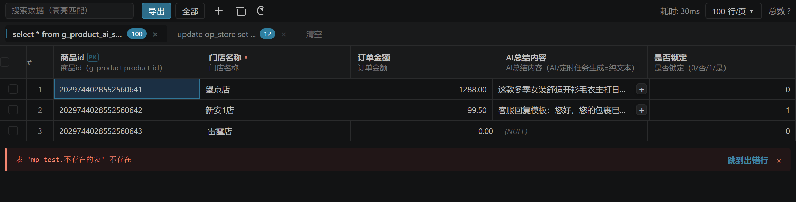
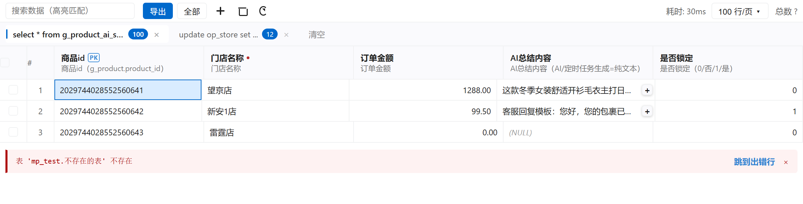

<div align="center">

# MySQL Custom

**一个专注 MySQL / MariaDB 的 VS Code 扩展，为超长复杂 SQL 而生。**

[](LICENSE)
[](https://code.visualstudio.com/)
[](https://www.mysql.com/)

[English](README.md) · [简体中文](README_CN.md)



</div>

---

## 为什么做这个

上游从 v4.7.0 起闭源。本项目以最后一个 MIT 版本（[cweijan/vscode-database-client](https://github.com/cweijan/vscode-database-client) **v3.9.8**，无任何付费校验）为基底，针对一套真实的线上代码库做了定向改进：

| | |
|---|---|
| Mapper 文件 | **1,093** 个 MyBatis XML |
| SQL 语句 | **3,649** 条 |
| 平均长度 | **568** 字符 |
| 最长单条 | **19,419** 字符、**44** 个 JOIN |
| 单条最多 JOIN | **64** 个 |
| JOIN 使用率 | 约 1/3 的语句 |
| GROUP BY | 20.4% |
| FROM 子查询 | 8.1% |
| CTE | 31 条（13 条递归） |
| 窗口函数 | 56 条 |

下面的所有能力都是照这个场景调出来的，不是拿玩具 SQL 试的。

## 核心能力

<table>
<tr><td width="50%" valign="top">

### SQL 编辑器

- **文件写长后补全依然有效** —— 600 行以上照样能用
- `where a.` / `select a.` / `on a.` 后补全列名
- CTE 与派生表别名解析
- 中文表名 / 列名
- 模糊匹配：`ai` 命中 `g_product_ai`
- 130+ 函数，且只匹配后跟 `(` 的

</td><td width="50%" valign="top">

### 跳转

- `Ctrl`+点**表名** → 打开 DDL
- `Ctrl`+点**别名** → 解析到真实表
- `Ctrl`+点 `别名.字段` → 打开 DDL 并定位到该行
- `Ctrl`+点**裸字段** → 在当前语句各表里逐个找
- 大小写不敏感

</td></tr>
<tr><td valign="top">

### 结果页

- **Excel 式选区**：拖动、`Shift` 扩展、`Ctrl` 追加离散单元格
- **`Ctrl`+双击列头**可把该列追加到选区
- 双击单元格就地编辑，`Ctrl+S` 保存
- 列头显示字段名 + 注释 + 类型，带 PK / 非空标记
- 长内容查看器，JSON 自动美化

</td><td valign="top">

### 执行

- **多语句脚本逐条执行**
  - 每条语句的结果各成一个 tab
  - 遇到首个错误即停止（与 `mysql` 命令行一致），**已成功的语句结果保留**
  - 失败时：结果面板红条 + SQL 编辑器对应行红波浪线 + 跳到出错行
  - 成功时：**不显示任何提示**，直接出数据
- 识别 `DELIMITER`，存储过程不会被拆碎

</td></tr>
</table>

## 截图

<table>
<tr>
<td width="50%"><br><sub>深色</sub></td>
<td width="50%"><br><sub>浅色</sub></td>
</tr>
</table>

## 安装

### 从 Release 下载（现在就能用）

1. 打开 [Releases](https://github.com/jjb4150/mysql-custom/releases)
2. 下载最新的 `.vsix`
3. VS Code 里按 `Ctrl+Shift+P` → **Extensions: Install from VSIX...**

或者用命令行：

```bash
code --install-extension mysql-custom-0.1.0.vsix
```

### 从源码构建

```bash
git clone https://github.com/jjb4150/mysql-custom.git
cd mysql-custom
npm install
npx tsc --noEmit
npx webpack --mode=production
npx @vscode/vsce package --no-dependencies
code --install-extension mysql-custom-0.1.0.vsix
```

## 快速开始

1. 打开左侧 **Database** 面板
2. 点 **+**，选 **MySQL**，填主机 / 端口 / 用户 / 密码
3. 库只在内网可达时，打开 **SSH Tunnel**
4. 点表名浏览数据，或点 **Open Query** 写绑定该连接的 SQL

## 语法高亮

语法定义从「按关键字硬匹配」重写为「按 SQL 结构分层」，让表名、列名、数据类型、DDL 约束在视觉上彼此区分。

| 元素 | scope |
|---|---|
| 表名 | `entity.name.type.sql` |
| 列名、别名、字段 | `entity.name.variable.sql` |
| 关键字 | `keyword.control.sql` |
| 数据类型 | `storage.modifier.sql` |
| DDL 约束 | `entity.name.label.sql` |
| 函数 | `entity.name.function.sql` |
| 注释 | `--`、`#`、`/* */` |

已用六个内置主题做配色交叉验证。刻意避开 `keyword.*` 与 `storage.type.*` —— VS Code 1.145 的默认深色主题下这两类是红色。

## 界面语言

跟随 VS Code 的显示语言。英文与简体中文均为完整翻译。命令面板条目走 VS Code 标准的 `nls` 机制。

## 支持的数据库

正式支持 **MySQL / MariaDB**。PostgreSQL、SQL Server、SQLite 的连接代码保留着，但不是重点，测试覆盖也不如 MySQL。

不含 Redis、Elasticsearch、MongoDB、FTP 或 SSH 客户端功能。数据库连接的 SSH **隧道**是支持的。

## 隐私

**无遥测。除连接你指定的数据库外，不发起任何网络请求。**

上游 README 曾声明会收集匿名使用数据。本版本不含该代码，相关声明已删除。

## 已知限制

- **AnalyticDB** 连接报 `[13000] Illegal database ''`。ADB 疑似要求连接时必须指定库名，未验证。
- 超大表 Excel 导出仍可能 OOM（`node-xlsx` 必须全量在内存里构建）。
- 没有「双击列头边框自动适配列宽」。
- 没有连接池 —— 与 `USE` 语义冲突。

## 参与贡献

问题与 PR 都欢迎：[github.com/jjb4150/mysql-custom/issues](https://github.com/jjb4150/mysql-custom/issues)。发布流程见 [docs/RELEASING.md](docs/RELEASING.md)。

## 开源协议

MIT。原始作品 Copyright (c) 2019-2021 Weijan Chen，修改部分 Copyright (c) 2026 junbiaojin。

```
This product is a derivative work based on cweijan/vscode-database-client version 3.9.8
```

完整协议见 [LICENSE](LICENSE)。